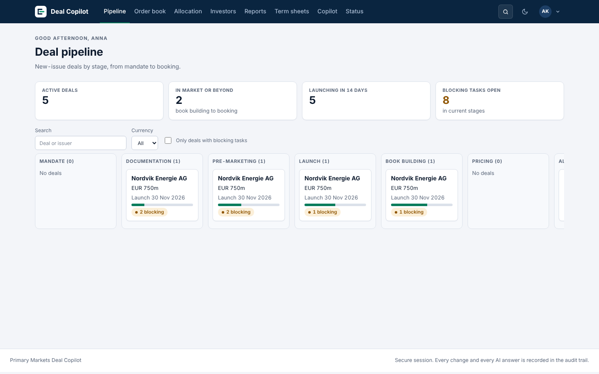
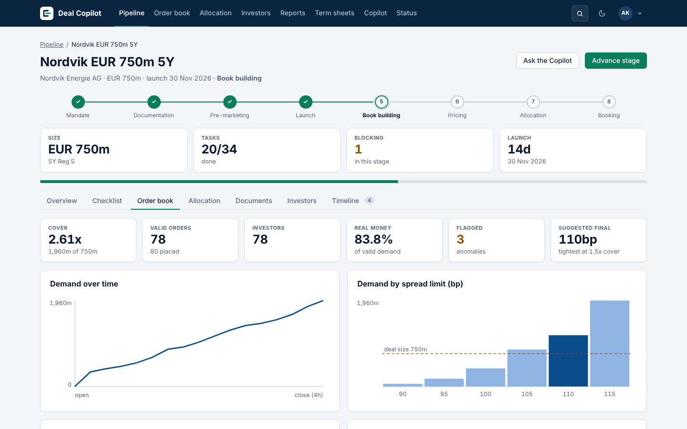
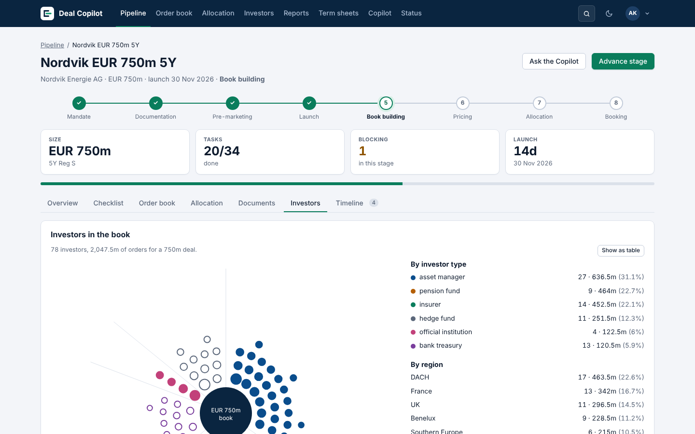
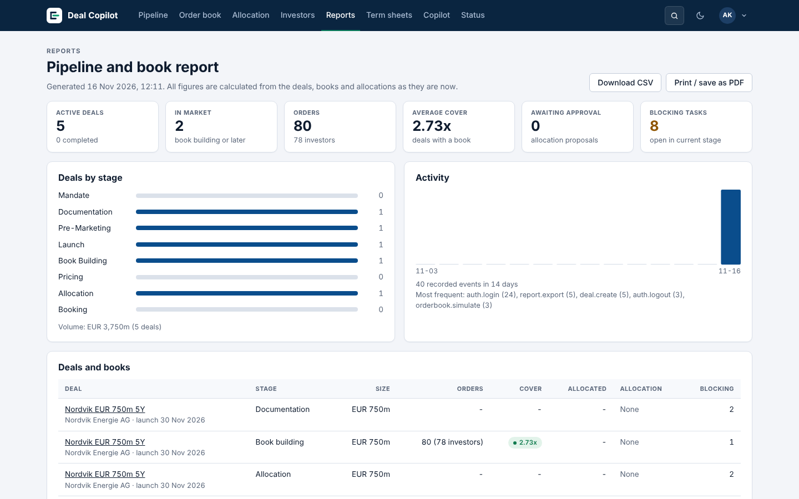
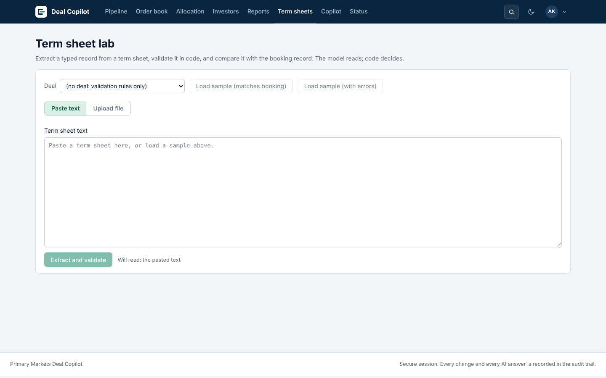
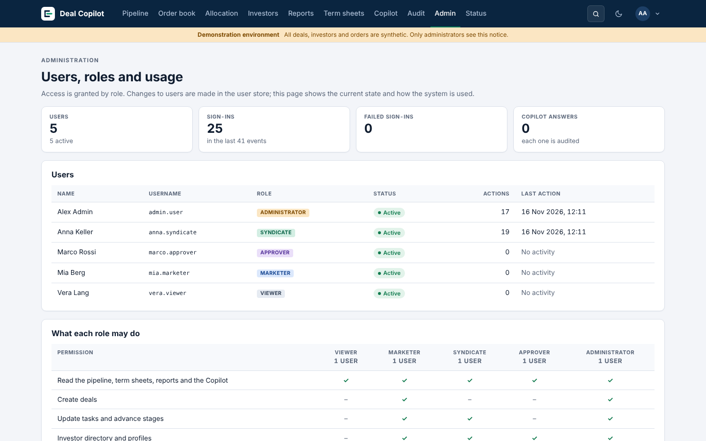
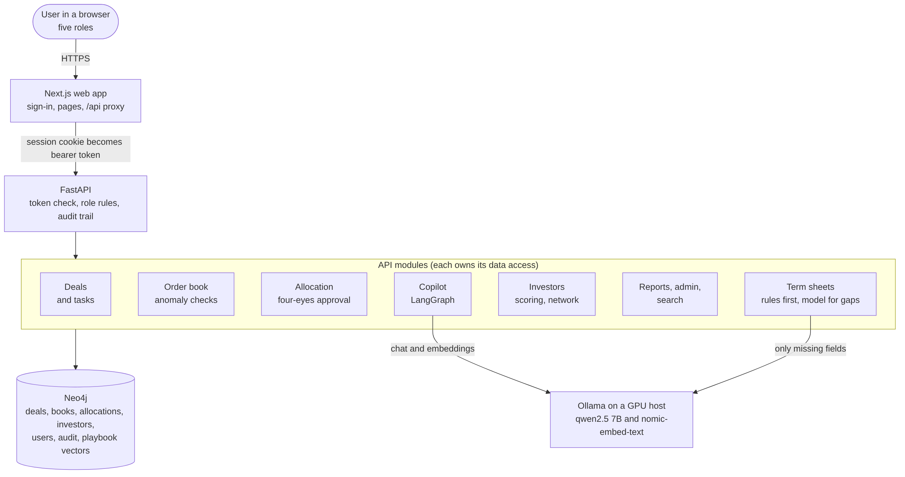

# Primary Markets Deal Copilot

A full-stack application for bond primary markets: deal workflow, order book and allocation, term sheet
extraction and validation, an investor network and an assistant that answers with sources. It runs locally with open-source LLMs
(Ollama), a Neo4j graph database, a FastAPI backend and a Next.js frontend.

## What it does

- **Deal pipeline and workspace:** eight stages from mandate to booking, tasks with owners and
  dependencies, readiness checks before a stage can advance.
- **Order book:** demand by spread, investor type and region, with anomaly detection.
- **Allocation:** an exact, tested engine with a four-eyes approval (the proposer cannot approve).
- **Term sheets:** PDF or text in six languages; fixed rules first, the model only for gaps, then
  validation against the deal.
- **Investors:** directory, profiles, a deal's investor network and an explainable target list.
- **Copilot:** answers from the deal data and a process playbook, with cited sources and a saved history.
- **Reports, admin console and search:** management roll-ups with CSV and print, users and roles, Ctrl+K.
- **Controls:** five roles enforced on the server, an audit trail of every change and every AI answer.
- **Runs anywhere:** Docker Compose for development, Kubernetes manifests for a cluster.

| Pipeline | Order book | Investor network |
|---|---|---|
|  |  |  |

| Reports | Term sheets | Admin |
|---|---|---|
|  |  |  |

## Status

| Step | Scope | State |
| --- | --- | --- |
| 0 | Repo, Docker Compose (dev and prod), health endpoint, CI | **done** |
| 1 | Neo4j schema, seed data, deals, audit, LLM client, Copilot with sources | **done** ([guide](docs/day-1-guide.md)) |
| 2 | Order book, allocation with four-eyes approval, term sheet extraction | **done** ([guide](docs/day-2-guide.md)) |
| 2b | Sign-in with roles, saved conversations, banking-style UI | **done** ([guide](docs/day-2b-guide.md)) |
| 3a | PDF term sheets, cleaning, rules before the model | **done** ([guide](docs/day-3a-guide.md)) |
| 3b | Investors, deal workspace, multi-language term sheets | **done** ([guide](docs/day-3b-guide.md)) |
| 3c | Reports, admin console, search, evaluation, new sign-in and logo | **done** ([guide](docs/day-3c-guide.md)) |
| K8s | Kubernetes manifests, build and deploy scripts, image workflow | **written, not yet run on a cluster** ([guide](docs/kubernetes-guide.md)) |
| Next | Users and desks in Neo4j, live public data (GLEIF, ECB, EDGAR), several agents | planned |

More: [architecture](docs/architecture.md), [evaluation](docs/evaluation.md), [demo script](docs/demo-script.md).

> **All data in this project is synthetic.** It uses no real client, investor or market data and
> connects to no bank system. It is a portfolio project, not a production banking system. It was
> built with AI assistance (see the end of this file).

## Architecture



Ollama runs natively on the host (not in Docker) so it can use the GPU; containers reach it at
`http://host.docker.internal:11434`. Only the API talks to Neo4j and Ollama.

## Prerequisites (Windows)

- Docker Desktop (running)
- Ollama (installed natively), NVIDIA driver
- Git

## Quick start

1. Check the machine and pull the models (about 5 GB download the first time):

   ```powershell
   powershell -ExecutionPolicy Bypass -File scripts\check-env.ps1
   ```

   It prints GPU memory before and after loading the model, so you can see your real VRAM use.

2. Create your development environment file and set a password:

   ```powershell
   copy .env.dev.example .env.dev
   ```

3. Start the development stack:

   ```powershell
   docker compose -p dealcopilot-dev --env-file .env.dev -f docker-compose.yml -f docker-compose.dev.yml up --build
   ```

4. Load the synthetic data (needs Ollama running, for the playbook embeddings):

   ```powershell
   docker compose -p dealcopilot-dev --env-file .env.dev -f docker-compose.yml -f docker-compose.dev.yml --profile tools run --rm seed
   ```

   It is safe to run again: existing deals are skipped. Add `--reset` at the end to wipe and reload
   (development only).

   The seed also creates the demo users. If you seeded before, build and run it again:
   `... --profile tools build seed`, then the run command above.

5. Open http://localhost:3000 and **sign in** (see below), then:
   - Frontend: http://localhost:3000 (pipeline), `/orderbook`, `/allocation`, `/investors`, `/reports`, `/termsheets`, `/copilot`, `/audit`, `/admin`, `/status`
   - API docs: http://localhost:8000/docs
   - API health: http://localhost:8000/api/v1/health
   - Neo4j Browser: http://localhost:7474 (user `neo4j`, password from `.env.dev`)

Day 2: open **Allocation** with `D-2026-009` and check the sum equals the deal size; open **Term sheets**, load the sample with errors and look for the red mismatch (details in the Day 2 guide).

### Sign-in and demo users

| Username | Role |
| --- | --- |
| `anna.syndicate` | syndicate: order book, propose allocation |
| `marco.approver` | approver: approve allocation |
| `mia.marketer` | marketer: create and edit deals |
| `vera.viewer` | viewer: read and Copilot |
| `admin.user` | admin: audit trail, admin console |

Password: `DEMO_USER_PASSWORD` from `.env.dev`, or `DealCopilot-Demo-1` when it is empty. These are
development accounts for synthetic data. Production needs its own `JWT_SECRET` (see `.env.prod.example`).

Try the Day 1 gate: open **Copilot**, choose *Nordvik EUR 750m 5Y*, ask
*"What is left before launch?"*. The answer must list the open tasks, and the *Evidence* panel shows
the exact sources. Sign in as different users to see what each role can do. The Copilot keeps your conversations in the sidebar and understands follow-up questions.

The status page (`/status`) shows `ok` for both Neo4j and Ollama when everything is wired up. If Ollama shows
as unreachable from the containers, set the Windows environment variable `OLLAMA_HOST=0.0.0.0`,
restart Ollama, and allow it through the firewall for private networks only.

## Development and production separation

The two environments share the code but nothing else.

| | Development | Production |
| --- | --- | --- |
| Git branch | `develop` | `main` |
| Env file | `.env.dev` | `.env.prod` |
| Compose project | `dealcopilot-dev` | `dealcopilot-prod` |
| Ports (frontend / API) | 3000 / 8000 | 3100 / 8100 |
| Neo4j published | yes (7474, 7687) | no |
| Neo4j data volume | its own | its own |
| API reload on code change | yes | no |

Run production locally:

```powershell
copy .env.prod.example .env.prod   # then set a different, strong password
docker compose -p dealcopilot-prod --env-file .env.prod -f docker-compose.yml -f docker-compose.prod.yml up --build -d
```

Because each project name has its own containers, network and Neo4j volume, deleting or reseeding
the development database cannot touch production data.

### Branch workflow

- Work on feature branches, open pull requests into `develop`.
- Release by a pull request from `develop` into `main`, with green CI and a review.
- Protect `main` in the repository settings (no direct pushes, CI required).
- Never commit `.env.dev` or `.env.prod`. Only the `*.example` files are tracked.

## Running without Docker (faster edit loop)

Backend:

```powershell
cd backend
python -m venv .venv
.venv\Scripts\activate
pip install -e ".[dev]" -c constraints.txt
$env:NEO4J_URI = "bolt://localhost:7687"; $env:OLLAMA_BASE_URL = "http://localhost:11434"
uvicorn app.main:app --reload
```

Frontend:

```powershell
cd frontend
npm install
npm run dev
```

## Kubernetes

The application also runs on any Kubernetes cluster: manifests for Neo4j, the API, the web app and
the ingress, a local and a production overlay, and scripts to build, push and deploy the images.
See [docs/kubernetes-guide.md](docs/kubernetes-guide.md).

## Evaluation

```powershell
cd backend
python -m app.evals termsheets      # offline: 49 of 49 fields right (a regression set)
python -m app.evals copilot --password <password>   # needs the running stack
```

See [docs/evaluation.md](docs/evaluation.md) for what is and is not measured.

## Quality checks

```powershell
cd backend;  ruff check .; ruff format --check .; mypy app; pytest -q
cd frontend; npm run lint; npm test; npm run build
```

`pytest` skips the Neo4j integration tests unless `TEST_NEO4J_URI` is set (see
`backend/tests/test_integration_neo4j.py`); CI runs them against a Neo4j service container.

CI (`.github/workflows/ci.yml`) runs the same checks on every push and pull request to `main` and
`develop`, validates both Compose stacks and checks the Kubernetes manifests.

## Repository layout

```
backend/            FastAPI app: core, health, and one folder per module
  app/deals/ orderbook/ allocation/ investors/ termsheets/ copilot/   (domain modules)
  app/reports/ admin/ search/ audit/ auth/ evals/                     (roll-ups, governance, quality)
frontend/           Next.js (App Router, TypeScript)
deploy/             Kubernetes manifests (Kustomize) and build/deploy scripts
docs/               guides, architecture, evaluation, demo script, images
scripts/            check-env.ps1 (Windows environment check)
docker-compose.yml  base stack; dev and prod overrides alongside
.github/workflows/  CI and image build
```

Module rule for later scaling: modules never import each other's internals and each owns its own
data access, so any module can be split into a service later.


## Limits

This is a portfolio project on synthetic data. A real bank would additionally need identity and entitlements (SSO), a security and
model-risk review, data governance, resilience and performance testing, and integration with the real
systems of record.
