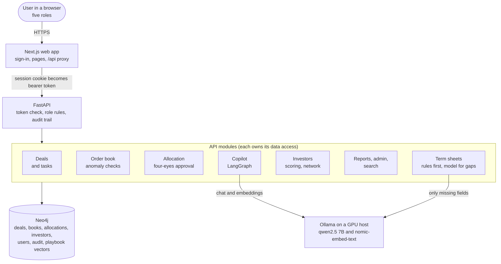
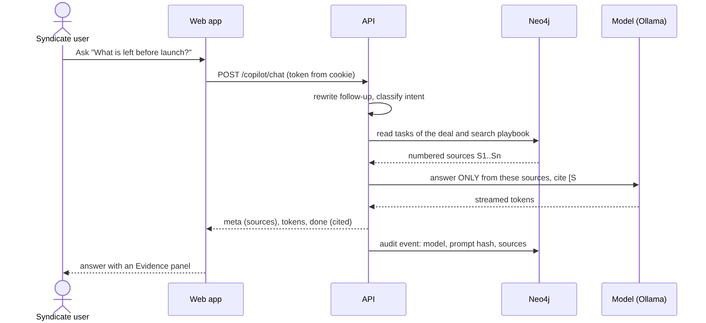

# Architecture

## The pieces

| Piece | Role |
|---|---|
| **Next.js web app** | Pages for each role. Holds the session in an `httpOnly` cookie and forwards `/api/*` calls to the API, adding the token. The browser never sees the API address or the token. |
| **FastAPI** | Checks the signed token on every request, applies role rules, runs the modules and writes the audit trail. |
| **Neo4j** | Deals, tasks and their dependencies, order books, allocations, investors, users, audit events and the playbook text with its vectors. A graph fits because most questions follow relationships: deal to tasks, investor to orders to deals. |
| **Ollama** | Runs the language model (`qwen2.5:7b-instruct`) and the embedding model (`nomic-embed-text`) locally, so no data leaves the machine. |

## How the main features work

**Copilot.** A small LangGraph pipeline: rewrite a follow-up into a standalone question, classify
the intent, read the deal's tasks and search the playbook, then ask the model to answer *only* from
the numbered sources. The answer streams to the browser with the sources, and the audit trail stores
the model name, a prompt hash and the sources used.

**Term sheets: "the model reads, the code decides".** Fixed rules read what has a clear pattern
(headline, labelled rows, ISIN with a checksum, dates, amounts, six languages). The model is asked
only for the required fields the rules could not find, from the passages most likely to hold them.
Rule values always win over the model's. Validation checks the result against the deal.

**Order book and allocation.** The book is checked for anomalies (duplicates, unusual ticket sizes,
orders after close). The allocation engine is plain, tested code; the model only writes an
explanation, which is accepted only if every number in it matches the engine's result. An allocation
needs two people: the one who proposes cannot approve.

**Investors.** Investor scoring is explainable arithmetic (real-money status, past participation,
ticket fit, region gap), shown with its reasons, never a black box.

## Design decisions

- **Modules own their data access.** No module imports another's internals, so any of them can later
  become a service.
- **Roles are checked on the server**; the menu only hides what a role cannot use.
- **Everything that changes data, and every AI answer, is audited.**
- **Dev and production are separate** (own containers, ports and database volume).
- **Runs the same on Docker Compose and Kubernetes** (`docs/kubernetes-guide.md`).

## What it is not

A demonstration on synthetic data. It has no connection to a bank system, no market data feed and no
production-grade identity provider; users live in the database and passwords are hashed.
